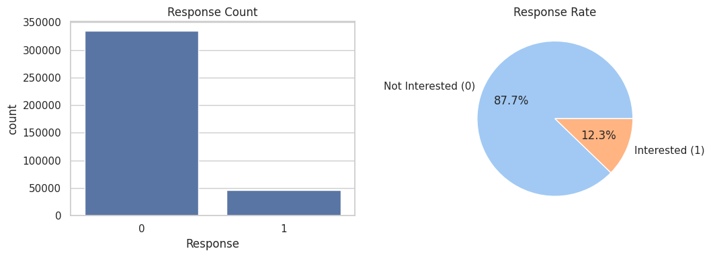
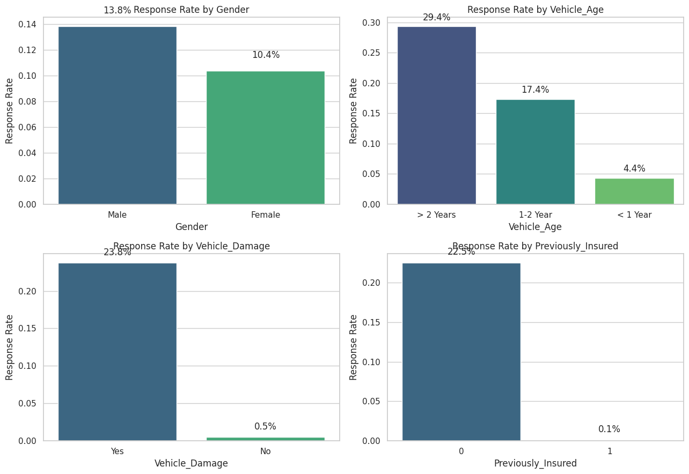
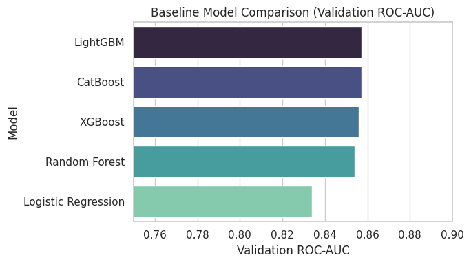
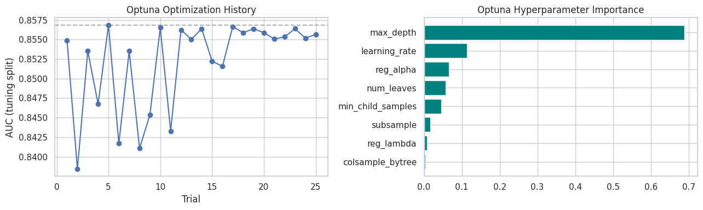
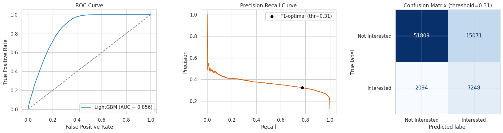
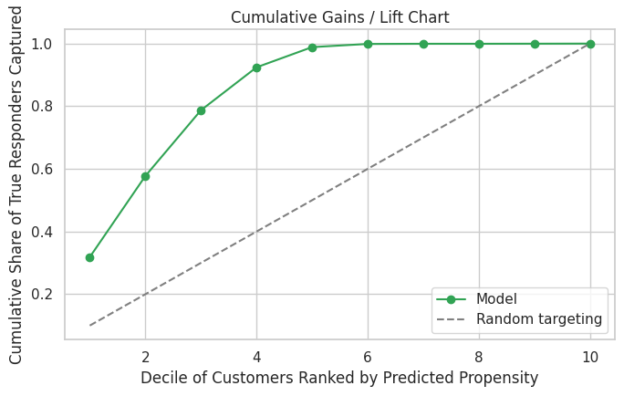
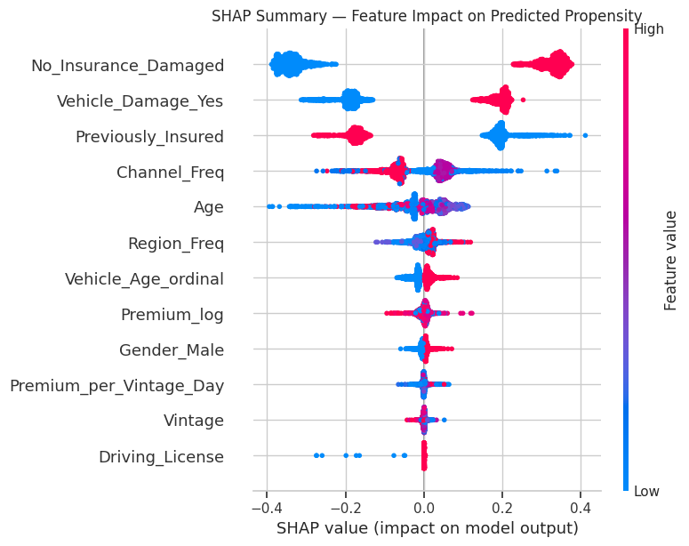
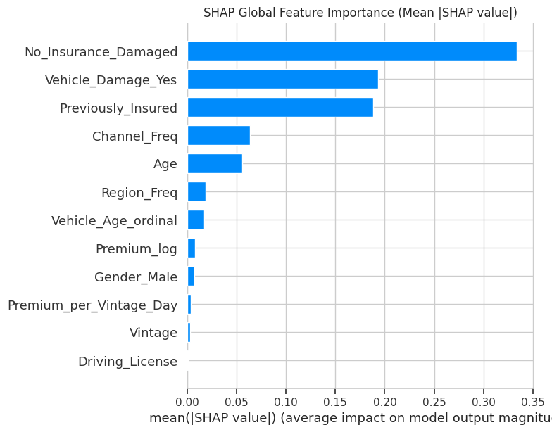
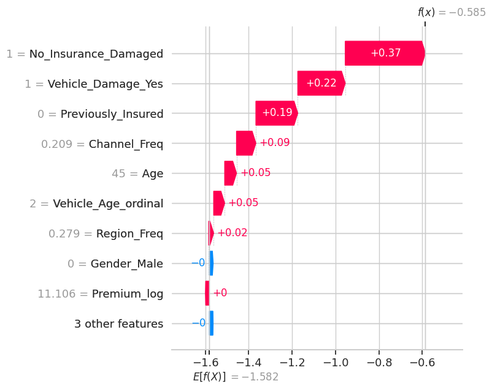

# Vehicle Insurance Cross-Sell Prediction

Predicting which health-insurance customers are likely to buy vehicle insurance, so a company can target its marketing spend instead of contacting its entire customer base.


---

## Table of Contents

- [Project Overview](#project-overview)
- [Business Problem](#business-problem)
- [Business Objective](#business-objective)
- [Executive Summary](#executive-summary)
- [Dataset Overview](#dataset-overview)
- [Feature Description](#feature-description)
- [Project Workflow](#project-workflow)
- [Exploratory Data Analysis](#exploratory-data-analysis)
- [Feature Engineering](#feature-engineering)
- [Model Comparison](#model-comparison)
- [Final Model](#final-model)
- [Final Evaluation Metrics](#final-evaluation-metrics)
- [Why ROC-AUC Was Chosen](#why-roc-auc-was-chosen)
- [Threshold Optimization](#threshold-optimization)
- [Lift / Decile Analysis](#lift--decile-analysis)
- [Model Explainability (SHAP)](#model-explainability-shap)
- [Key Business Insights](#key-business-insights)
- [Business Recommendations](#business-recommendations)
- [Repository Structure](#repository-structure)
- [Installation](#installation)
- [Requirements](#requirements)
- [Future Improvements](#future-improvements)
- [Author](#author)
- [License](#license)

---

## Project Overview

An end-to-end supervised machine learning project that scores existing health-insurance customers on their likelihood of buying vehicle insurance. The project covers EDA, feature engineering, a five-model baseline comparison, Optuna-driven hyperparameter tuning, threshold and lift analysis, and SHAP-based explainability — closing the loop from raw data to concrete targeting recommendations.

## Business Problem

An insurance company already sells Health Insurance to its customers and wants to know which of those customers would also be interested in **Vehicle Insurance**. Buying interest depends on demographics (age, gender), the customer's vehicle (age, prior damage), and their existing policy (premium, sourcing channel, tenure) — not on any single obvious factor.

## Business Objective

Build a model that outputs a **propensity-to-buy score** for each customer, evaluate it with a metric that actually reflects the targeting use case (not raw accuracy), explain *why* it scores customers the way it does, and translate the findings into specific, actionable targeting recommendations.

## Executive Summary

- Compared 5 models (Logistic Regression, Random Forest, XGBoost, LightGBM, CatBoost) on a stratified 80/20 split of 381,109 customers.
- All four tree-based models converged within ~0.003 AUC of each other (0.854–0.857); **LightGBM** was selected for its combination of top accuracy and fastest training time, then tuned with **Optuna** (25 trials, TPE sampler).
- Final tuned model: **Validation ROC-AUC = 0.8559**.
- Because the target is imbalanced (~12.3% positive), the notebook explicitly shows why the default 0.5 classification threshold fails (precision/recall/F1 collapse to ~0) and instead reports an F1-optimal threshold and a **lift/decile table**: contacting only the top 10% of customers by predicted propensity captures **31.9% of all true responders — a 3.2x lift over random targeting**.
- SHAP confirms `Previously_Insured`, `Vehicle_Damage_Yes`, and an engineered `No_Insurance_Damaged` interaction feature are the dominant drivers, both globally and in individual predictions.

## Dataset Overview

| | Train | Test (unlabeled) |
|---|---|---|
| Rows | 381,109 | 127,037 |
| Columns | 12 (incl. target `Response`) | 11 |
| Missing values | 0 | 0 |
| Duplicate rows | 0 | — |
| Target positive rate | 12.26% | n/a |

`test.csv` is the original competition's unlabeled scoring set — it has no `Response` column and is **not** used anywhere in model training or evaluation. All results in this repository come from an internal, stratified train/validation split of `train.csv` only.

## Feature Description

| Raw Feature | Description |
|---|---|
| `Gender` | Customer gender |
| `Age` | Customer age |
| `Driving_License` | 1 if the customer holds a driving license |
| `Region_Code` | Encoded region identifier |
| `Previously_Insured` | 1 if the customer already has vehicle insurance |
| `Vehicle_Age` | Age bracket of the customer's vehicle |
| `Vehicle_Damage` | Whether the vehicle was damaged in the past |
| `Annual_Premium` | Amount the customer pays as premium |
| `Policy_Sales_Channel` | Anonymized code of the outreach channel |
| `Vintage` | Number of days the customer has been associated with the company |
| `Response` (target) | 1 if the customer is interested in vehicle insurance |

## Project Workflow

1. Setup & Data Loading
2. Data Understanding & Quality Checks
3. Exploratory Data Analysis
4. Feature Engineering
5. Train/Validation Split & Class Imbalance Handling
6. Baseline Model Comparison (5 models)
7. Hyperparameter Optimization (Optuna)
8. Final Model Evaluation (threshold analysis, lift/decile table)
9. Model Explainability (SHAP)
10. Business Insights & Recommendations

## Exploratory Data Analysis

- The target is imbalanced: **12.26%** of customers responded positively.
- `Annual_Premium` is heavily right-skewed (99th percentile ≈ 72,963 vs. a max of 540,165), motivating a log transform.
- `Vehicle_Damage` is the single strongest categorical split — damaged-vehicle customers convert at a far higher rate.
- `Previously_Insured` customers almost never respond, which makes intuitive sense (nothing to cross-sell).
- `Vehicle_Age` shows a monotonic relationship with response rate: older vehicles → higher interest.
- No single raw numeric feature is strongly correlated with `Response` in isolation — the real signal comes from categorical splits and their interactions, not a linear numeric driver.




## Feature Engineering

| Engineered Feature | Rationale |
|---|---|
| `Gender_Male` | Binary-encode the 2-level categorical |
| `Vehicle_Damage_Yes` | Binary-encode the 2-level categorical |
| `Vehicle_Age_ordinal` | `Vehicle_Age` is naturally ordered; ordinal encoding preserves that order for the model |
| `Premium_log` | Reduces the influence of the long right tail in `Annual_Premium` |
| `Premium_per_Vintage_Day` | Premium relative to tenure — a proxy for relationship "value density" |
| `No_Insurance_Damaged` | Interaction flag for customers with no prior vehicle insurance **and** a history of vehicle damage — the EDA-identified high-propensity segment |
| `Region_Freq`, `Channel_Freq` | Frequency-encodes high-cardinality `Region_Code` / `Policy_Sales_Channel` IDs, fit on the training split only to avoid leakage |

`Driving_License` is kept binary as-is; `Age` and `Vintage` are used directly.

## Model Comparison

Five models trained on the identical stratified 80/20 split (304,887 train / 76,222 validation rows), evaluated on validation ROC-AUC:

| Rank | Model | Validation ROC-AUC |
|---|---|---|
| 1 | **LightGBM** | **0.8573** |
| 2 | CatBoost | 0.8572 |
| 3 | XGBoost | 0.8560 |
| 4 | Random Forest | 0.8540 |
| 5 | Logistic Regression | 0.8340 |



The four tree-based models land within ~0.003 AUC of each other — the realistic ceiling for this feature set, not measurement noise. Logistic Regression trails by roughly 2 points of AUC, confirming there is genuine non-linear signal (e.g. the `Previously_Insured` × `Vehicle_Damage` interaction) that a linear model underfits.

## Final Model

**LightGBM**, selected for matching the top baseline AUC while training substantially faster than CatBoost or Random Forest — the deciding factor for making an Optuna search practical.

Tuned with **Optuna** (TPE sampler, 25 trials) on an internal split of the training data, with early stopping, keeping the true validation set completely untouched until final evaluation.



**Best hyperparameters found:**

| Parameter | Value |
|---|---|
| `learning_rate` | 0.0119 |
| `num_leaves` | 122 |
| `max_depth` | 10 |
| `min_child_samples` | 83 |
| `subsample` | 0.722 |
| `colsample_bytree` | 0.639 |
| `reg_alpha` | 0.546 |
| `reg_lambda` | 0.058 |

The final model was retrained on the full training split with these parameters, using early stopping against the held-out validation set (best iteration: **33**).

## Final Evaluation Metrics

| Metric | Value |
|---|---|
| Validation ROC-AUC | **0.8559** |
| F1-optimal threshold | 0.3063 |
| Precision @ optimal threshold | 0.3247 |
| Recall @ optimal threshold | 0.7759 |
| F1 @ optimal threshold | 0.4579 |

Classification report at the F1-optimal threshold:

| Class | Precision | Recall | F1 | Support |
|---|---|---|---|---|
| Not Interested | 0.96 | 0.77 | 0.86 | 66,880 |
| Interested | 0.32 | 0.78 | 0.46 | 9,342 |



## Why ROC-AUC Was Chosen

The target is imbalanced (~88% negative / ~12% positive). At the default 0.5 probability threshold, the model — like most models trained on this kind of split — predicts almost nobody as "interested," because 0.5 sits far above the base rate:

| Metric @ 0.5 threshold | Value |
|---|---|
| Accuracy | 0.8774 |
| Precision | 0.0000 |
| Recall | 0.0000 |
| F1 | 0.0000 |

87.7% "accuracy" here is meaningless — it's approximately equal to just guessing "not interested" for every customer. ROC-AUC measures the model's ability to **rank** interested customers above uninterested ones across all thresholds, which is what a targeting use case actually needs: the campaign team doesn't need a fixed cutoff, they need a ranked list.

## Threshold Optimization

The default 0.5 threshold was replaced with a threshold chosen from the precision-recall curve to maximize F1: **0.3063**, giving precision 0.32 / recall 0.78 / F1 0.46 — a deliberate, business-informed trade-off rather than a default that silently fails.

## Lift / Decile Analysis

Rather than a hard classification cutoff, the realistic deployment pattern is: **rank every customer by predicted propensity, then contact the top X%.**

| Decile | Customers | Responders Captured | Cumulative Capture | Lift vs. Random |
|---|---|---|---|---|
| 1 (top 10%) | 7,623 | 2,976 | 31.9% | 3.19x |
| 2 | 7,622 | 2,417 | 57.7% | 2.59x |
| 3 | 7,622 | 1,961 | 78.7% | 2.10x |
| 4 | 7,622 | 1,280 | 92.4% | 1.37x |
| 5 | 7,622 | 603 | 98.9% | 0.65x |



Contacting only the top 10% of the ranked customer base captures **31.9% of all true responders — a 3.2x lift over contacting a random 10%.** By the 4th decile (top 40%), the model has already captured over 92% of responders, at which point continued outreach has sharply diminishing returns.

## Model Explainability (SHAP)




`Previously_Insured` and `Vehicle_Damage_Yes` dominate the global SHAP ranking, followed by the engineered `No_Insurance_Damaged` interaction and `Vehicle_Age_ordinal` — consistent with the EDA findings above. `Age` and `Vintage` contribute, but with more spread, meaning their effect depends on a customer's other attributes.

**Local explanation** for one individual, high-scoring customer:



For this customer, `No_Insurance_Damaged = 1` (+0.37), `Vehicle_Damage_Yes = 1` (+0.22), and `Previously_Insured = 0` (+0.19) are the largest positive contributors to their propensity score — traceable feature-by-feature from the model's base rate, the level of explanation a business stakeholder or compliance reviewer can ask for on any individual prediction.

## Key Business Insights

- Customers with **no prior vehicle insurance and a history of vehicle damage** (`No_Insurance_Damaged`) are the clearest high-propensity segment, confirmed by both the EDA and SHAP.
- Customers who are `Previously_Insured` convert at a near-zero rate — excluding them from the campaign list entirely is a legitimate cost-saving step, not just a model artifact.
- Older vehicles (`Vehicle_Age_ordinal = 2`, i.e. > 2 years) show materially higher response, suggesting a natural campaign trigger point (e.g. around vehicle renewal time).

## Business Recommendations

1. **Deploy as a ranking tool, not a hard classifier.** Score the full customer base periodically and let the campaign budget determine how far down the ranked list to go — the lift table above quantifies that trade-off directly.
2. **Prioritize the `No_Insurance_Damaged` segment** first in any outbound campaign.
3. **Exclude `Previously_Insured` customers** from the campaign list rather than deprioritizing them.
4. **Use rank/decile, not raw probability**, when communicating "propensity" to non-technical stakeholders, since probabilities are not perfectly calibrated under the class-imbalance re-weighting used here.
5. **Be explicit about the model's ceiling**: a validation ROC-AUC of ~0.86 is a strong, reproducible result for this feature set, but a meaningful share of customer interest likely depends on factors not present in this dataset (e.g. actual outreach history, competitor pricing, life events). Framed honestly, this is a first-generation model, not a finished product.

## Repository Structure

```
Vehicle-Insurance-Cross-Sell-Prediction/
├── notebook/
│   └── Vehicle_Insurance_Cross_Sell_Prediction.ipynb
├── images/
│   ├── 01_target_response_distribution.png
│   ├── 02_numeric_feature_distributions.png
│   ├── 03_annual_premium_outliers.png
│   ├── 04_age_vs_premium_by_response.png
│   ├── 05_response_rate_by_category.png
│   ├── 06_correlation_heatmap.png
│   ├── 07_baseline_model_comparison.png
│   ├── 08_optuna_tuning_history.png
│   ├── 09_roc_pr_confusion_matrix.png
│   ├── 10_lift_gains_chart.png
│   ├── 11_shap_summary_beeswarm.png
│   ├── 12_shap_global_importance_bar.png
│   └── 13_shap_local_waterfall.png
├── data/
│   └── README.md          # download instructions (raw CSVs are not committed — see .gitignore)
├── requirements.txt
├── README.md
├── LICENSE
└── .gitignore
```

> Note: an `app/` folder for a Streamlit demo is intentionally **not** included in this v1.0.0 release — see [Future Improvements](#future-improvements).

## Installation

```bash
git clone https://github.com/<your-username>/Vehicle-Insurance-Cross-Sell-Prediction.git
cd Vehicle-Insurance-Cross-Sell-Prediction
pip install -r requirements.txt
```

Download `train.csv`, `test.csv`, and `sample_submission.csv` from the [Health Insurance Cross Sell Prediction dataset on Kaggle](https://www.kaggle.com/datasets/anmolkumar/health-insurance-cross-sell-prediction) and place them in `data/`, then open `notebook/Vehicle_Insurance_Cross_Sell_Prediction.ipynb`.

## Requirements

See [`requirements.txt`](requirements.txt) for the full pinned list. Core libraries: `pandas`, `numpy`, `scikit-learn`, `xgboost`, `lightgbm`, `catboost`, `optuna`, `shap`, `matplotlib`, `seaborn`.

## Future Improvements

- Add behavioral/contact-history features if available (this dataset only covers demographic + policy attributes).
- Explore model calibration (e.g. Platt scaling) if a stakeholder specifically needs interpretable probabilities rather than a rank/decile.
- Package the scoring pipeline behind a lightweight Streamlit demo (see the deployment plan tracked separately for this repository) for interactive what-if exploration.
- Track performance drift if deployed, since the training data reflects a single historical period.

## Author

**Rajveer Singh**
M.Sc. Statistics, Banaras Hindu University (BHU)
[LinkedIn](https://www.linkedin.com/in/rajveer-singh-38b52025b) · [GitHub](https://github.com/singhrajveervns-gif)

## License

This project is licensed under the [MIT License](LICENSE).
